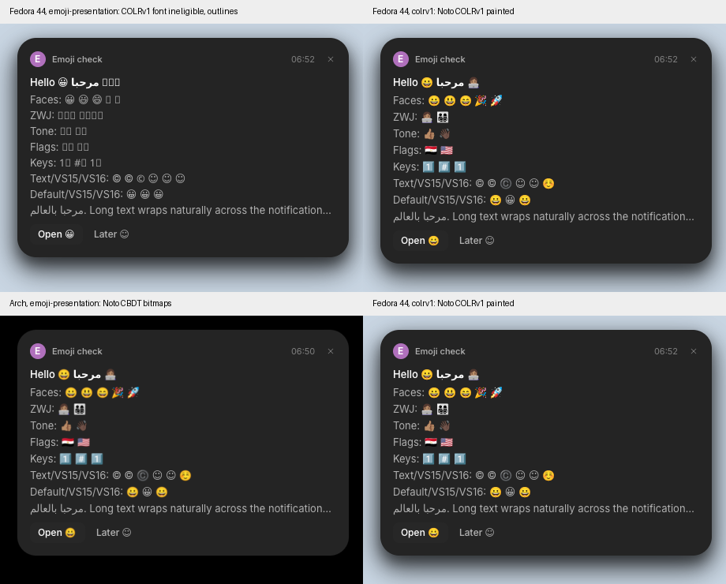
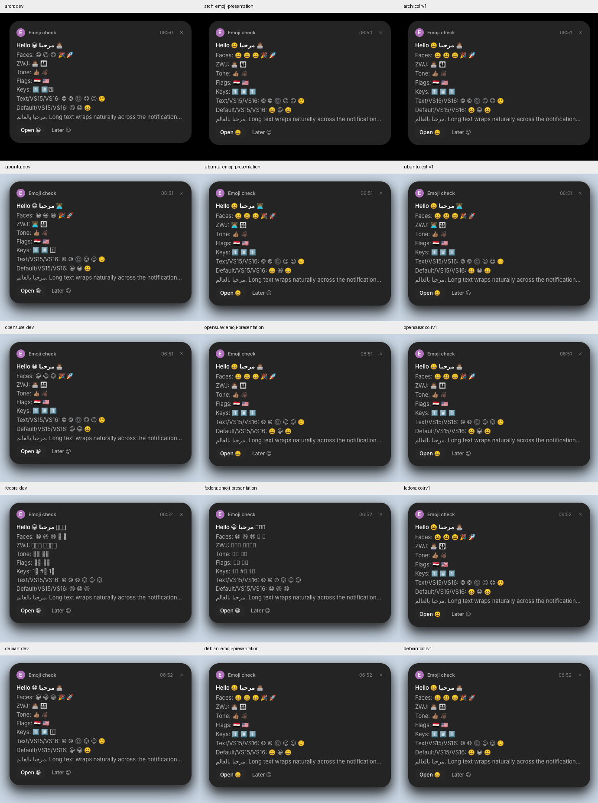
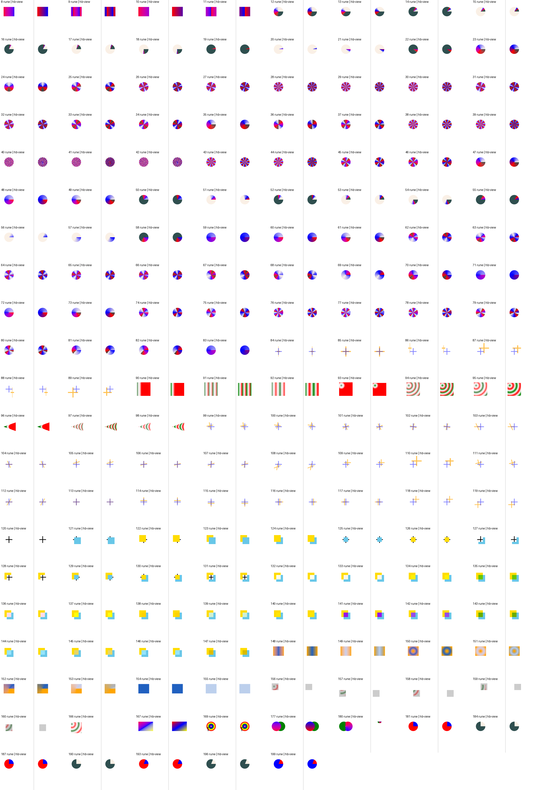

# COLRv1 emoji verification

Code revisions tested:

| Repository / branch | Revision | Role |
|---|---|---|
| anomalyco/hokum dev | f30af6ae2762bf9a3b41b9cbccac6e01cbed08ab | Unchanged baseline (`dev`) |
| salemsayed/hokum emoji-presentation | 4ca7b9b86e9814de783522d15496f32f67a633c6 | Emoji presentation fix only (`branch`) |
| salemsayed/hokum emoji-presentation-colrv1 | 6ecf26d11cffce096136b18964030a473f986ae6 | Presentation fix plus COLRv1 painter (`colrv1`) |
| salemsayed/rune colrv1 | fca6fb3ca8c06d7271d570952600f00ca5f9fbe2 | COLRv1 painter, stacked on emoji-presentation 7b92c9bd |
| salemsayed/rune colrv1-hokum | 2b84bea0cac5e8f5597fbd095076904c7f6f840f | Same change on emoji-presentation-hokum 57e19975 (Hokum's Rune pin 49acd141 plus the presentation fix) |

Executables were built with upstream `scripts/build-linux.sh` on Ubuntu 24.04, which also renders its four snapshot smoke tests. SHA256: `dev` 51c549101ca09267f160e37aaf2fceda8fd7ebcdb7e16343955961d450699f63, `branch` c14bbf98b7f6c1dcd71bc665810463fb67fe52dacd9d7ad5d71ab0d2b66d6f83 (byte-identical to the executable in [emoji-presentation](../emoji-presentation)), `colrv1` 34189fb802c4b55a5688382e08c4e2f2d19081f4f92ccc61a73115eb5ead38d6.

## Fedora against Arch

Fedora 44 installs `Noto-COLRv1.ttf` (`google-noto-color-emoji-fonts-20260921-1.fc44`); fontconfig's `emoji` match is that file. Arch installs the CBDT `NotoColorEmoji.ttf` (`noto-fonts-emoji 1:20260924-1`). Both cards use the same stress notification at the same size.

Measured inside the card (395 × 240 px below the header), Fedora with `colrv1` and Arch with `branch` differ in 4,278 of 94,800 pixels, 944 of them by more than 24 of 255 on some channel. Every differing pixel lies inside an emoji ([diff](fedora-vs-arch-diff.png), differing pixels in magenta). Text, line positions and the card's height are identical. The differences are vector edges against downscaled bitmaps, and the two font releases are three days apart. The [2x crop](fedora-vs-arch-zoom.png) shows faces, ZWJ families and professions, skin tones, flags and keycaps side by side.

## Five-distro matrix

[`matrix-results.json`](matrix-results.json) counts full-screen differing pixels with and without the clock column masked.

| Distro | Emoji card, colrv1 vs branch | Stock cards, colrv1 vs dev | Unmasked differences |
|---|---|---|---|
| Arch | 0 px | 0 px | Clock only: 222 (emoji), 666 (stock) |
| Ubuntu 24.04 | 0 px | 0 px | None |
| openSUSE Tumbleweed | 0 px | 0 px | Clock only: 678 (stock) |
| Fedora 44 | 44,784 px: outlines and missing boxes become colour emoji | 0 px | 48,032 px including the clock (emoji) |
| Debian 13 | 0 px | 0 px | None |

`matrix/` holds every screenshot with the installed font inventory, the fontconfig `emoji` and `sans-serif:charset=1f600` matches and the OS version.

## Performance

Startup, from launching `hokum service` to its ownership of `org.freedesktop.Notifications`, 15 alternating runs each in fresh containers ([raw](startup-runs.tsv)):

| Run | Median | Quartiles | Range |
|---|---|---|---|
| Fedora, `branch` (COLRv1 font rejected) | 101 ms | 94–102 ms | 84–104 ms |
| Fedora, `colrv1` (COLRv1 font accepted) | 95 ms | 86–102 ms | 84–102 ms |
| Arch, `colrv1` (CBDT font) | 37 ms | 36–38 ms | 27–40 ms |

Fedora's startup does not change measurably; both Fedora runs are bimodal around 85 and 102 ms. The gap to Arch is the distribution, not the font format. The probe polls `gdbus` every 5 ms and does not include drawing the first card.

Raster cost per glyph, 16 Noto emoji, 40 alternating paired rounds after a warm-up, medians with quartiles ([raw](raster-bench.txt), [source](../colrv1-harness/unit)):

| Size | CBDT via swash | COLRv1 via the new painter |
|---|---|---|
| 20 px | 210 µs (209–210) | 118 µs (118–119) |
| 32 px | 240 µs (240–241) | 163 µs (163–164) |
| 64 px | 331 µs (331–331) | 313 µs (313–313) |

Each glyph is drawn once per size and ink and then cached, as before. Rune's library tests need debug assertions to compile, so this ran at opt-level 3 with debug assertions on, not `--profile perf`, while other builds were running on the machine. The CBDT figure includes PNG decoding and scaling the 136 × 128 bitmap; it does not include GPU upload.

## Renderer reference

Each COLRv1 glyph of Google's COLRv1 test font, drawn by the new painter at 48 px with ink `#2060c0`, beside HarfBuzz 8.3's `hb-view` (cairo 1.18) rendering of the same character on white. `hb-view` scales the font differently, so its glyphs are smaller. Gradients, sweep directions, extend modes, transforms, composite modes and the foreground colour agree. Glyphs 156 to 160, 166 and 180 draw other colour glyphs through `PaintColrGlyph`; `hb-view` 8.3 shows only a grey placeholder or a fragment for those, so it is no reference there, and the clip-box glyphs are checked by unit tests instead. This is a visual comparison, not a pixel diff. The painter interpolates gradients in premultiplied linear light, as the COLR specification requires; the interpolation `hb-view` uses was not checked.

## Limits

Measured in containers with headless sway and software rendering (pixman for the compositor, lavapipe for Hokum), not on full desktops or physical GPUs. Noto Color Emoji uses layers, glyph clips, clip boxes, solid fills, linear and radial gradients with pad, transforms and the `SRC_IN` and `SOFT_LIGHT` composite modes, so those are what the screenshots exercise; sweep gradients, repeat and reflect, the other composite modes and the foreground colour are covered by unit tests and the reference sheet only. Variable COLRv1 fonts were not tested. macOS, Windows, ARM64, Twemoji-style COLRv1 fonts and SVG-only fonts are unverified; SVG-only fonts stay ineligible.
