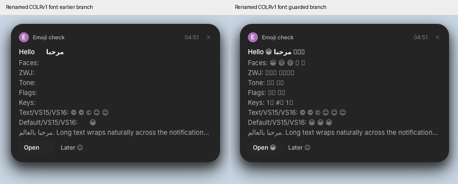

# Emoji presentation verification

Code revisions tested:

| Repository / branch | Revision | Role |
|---|---|---|
| anomalyco/hokum dev | f30af6ae2762bf9a3b41b9cbccac6e01cbed08ab | Unchanged baseline |
| salemsayed/hokum emoji-presentation | 4ca7b9b86e9814de783522d15496f32f67a633c6 | Downstream integration |
| salemsayed/rune emoji-presentation | 7b92c9bda5a21b4c94e322828f0094ab23b0f6ae | Fix against Rune dev 490df14d |
| salemsayed/rune emoji-presentation-hokum | 57e1997509f33126282e2e616a6deb371e5d0e26 | Same fix on Hokum's existing Rune pin 49acd141 |

The Hokum fork pin is provisional and the PR must remain a draft until Rune lands. Hokum contains one dependency-pin commit above its baseline. Accept the Rune change first, then use the accepted upstream URL/revision and rerun downstream verification before merging Hokum.

`matrix/` contains the complete screenshots, installed font inventories, fontconfig matches and OS versions. `no-color/` is the earlier Arch run with Noto Emoji removed, captured at Hokum `e1519cf7` and Rune backport `f14ea24f`. `matrix-results.json` records full-screen pixel differences with and without the clock column masked. Stock non-emoji cards have zero differences after the clock mask in every environment. The refreshed openSUSE raw difference is 651 clock pixels; all other raw differences are zero.

Hokum: 132 tests passed, clippy passed, formatting passed. Release-script builds on Ubuntu 24.04 passed their four snapshot checks. The real service matrix uses isolated headless sway sessions and session buses, with hardware modules and update checks disabled. Distro font packages are used; these are not full desktop installations. See [the harness](../emoji-harness).

Rune: the refreshed filtered emoji/routes/selection suite passes all 20 tests on each branch, including all nine new tests. The earlier current-dev unit/integration run has 2,180 passes, 10 failures and 12 ignored tests across 141 targets; the backport has 1,860 passes, 10 failures and 12 ignored tests across 123 targets. Those broad runs were recorded at current-dev `85e54fbf` and backport `f14ea24f`; they were not repeated for the guard revision. The broad suite is not green. Failing platform/video/font/GPU tests also reproduce on unchanged upstream. Current-dev doctests: 27 passed, 48 ignored. Current-dev library clippy and file/folder-size checks pass with existing warnings; the backport size check reproduces its unchanged baseline’s `overlay.rs` ceiling failure; default Linux test/check compilation, test-target clippy and repository-wide formatting have upstream failures. `test-results.json` records aggregate results and baseline checks.

Fedora 44's Noto font uses COLRv1 without v0 base-glyph records, which the current renderer does not support. The change retains available outlines and prevents invisible glyphs; it does not make that font render in colour. COLRv1 rendering remains unresolved. Windows, macOS, ARM64, physical GPUs, proprietary Segoe fonts and the installed desktop are unverified.

## Renamed-font regression

`fedora-renamed/` renames Fedora's unmodified `Noto-COLRv1.ttf` to `NotoColorEmoji.ttf`, exercising the symbol loader as well as fontconfig. The earlier build (Hokum `e1519cf7a8b33836f35c5ab637f1aeb392ceffbc`, Rune `f14ea24f15438cdc34494f67b728d76261ec99cf`) loses entire emoji rows. The guarded revisions in the table retain available outlines. Unsupported glyphs remain missing, and this does not add COLRv1 rendering.

Both discovery paths now inspect each loaded face through the retained source cache. Unsupported faces leave the collection and symbol stack. COLR tables with nonzero v0 base-glyph records are accepted regardless of version, matching swash. Regression tests exercise both the loaded-family path and this record-count rule. The earlier duplicate full-file validation read is removed.
