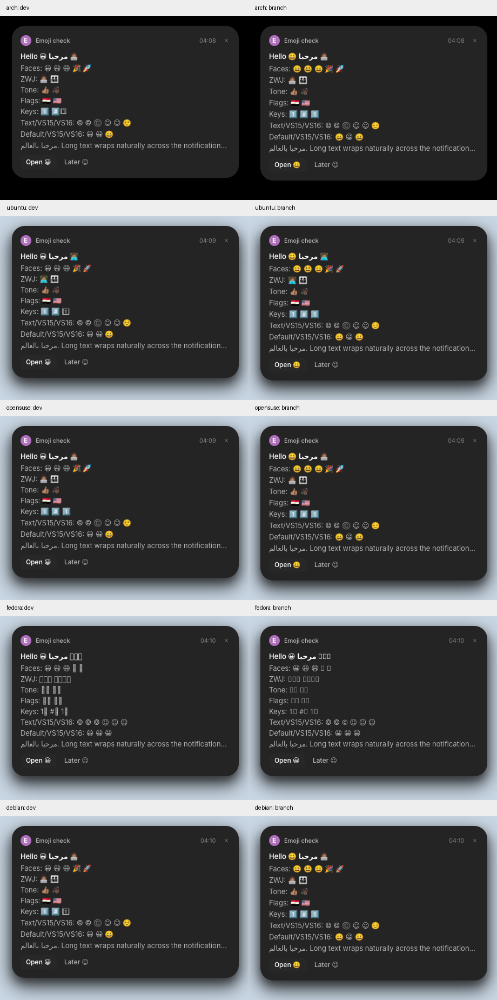

# Emoji presentation verification

Code revisions tested:

| Repository / branch | Revision | Role |
|---|---|---|
| anomalyco/hokum dev | f30af6ae2762bf9a3b41b9cbccac6e01cbed08ab | Unchanged baseline |
| salemsayed/hokum emoji-presentation | e1519cf7a8b33836f35c5ab637f1aeb392ceffbc | Downstream integration |
| salemsayed/rune emoji-presentation | 85e54fbf53f4f1ffe19ec66baa161c32ee18ee05 | Fix against Rune dev 490df14d |
| salemsayed/rune emoji-presentation-hokum | f14ea24f15438cdc34494f67b728d76261ec99cf | Same fix on Hokum's existing Rune pin 49acd141 |

The Hokum fork pin is provisional. Accept the Rune change first, then use the accepted upstream URL/revision and rerun downstream verification before merging Hokum.

`matrix/` contains the complete screenshots, installed font inventories, fontconfig matches and OS versions. `no-color/` is the separate Arch run with Noto Emoji removed. `matrix-results.json` records full-screen pixel differences with and without the clock column masked. Stock non-emoji cards have zero differences after the clock mask in every environment. The Arch raw difference is 150 clock pixels; all other raw differences are zero.

Hokum: 132 tests passed, clippy passed, formatting passed. Release-script builds on Ubuntu 24.04 passed their four snapshot checks. The real service matrix uses isolated headless sway sessions and session buses, with hardware modules and update checks disabled. Distro font packages are used; these are not full desktop installations. See [the harness](../emoji-harness).

Rune: all seven new tests, three existing emoji tests and the adjusted selection-geometry regression test pass. The final current-dev unit/integration run has 2,180 passes, 10 failures and 12 ignored tests across 141 targets; the backport has 1,860 passes, 10 failures and 12 ignored tests across 123 targets. The broad suite is not green. Failing platform/video/font/GPU tests also reproduce on unchanged upstream. Current-dev doctests: 27 passed, 48 ignored. Library clippy and file/folder-size checks pass with existing warnings; default Linux test/check compilation, test-target clippy and repository-wide formatting have upstream failures. `test-results.json` records aggregate results and baseline checks.

Fedora 44's Noto font uses COLRv1, which the current renderer does not support. The change retains available outlines and prevents invisible glyphs; it does not make that font render in colour. COLRv1 rendering remains unresolved. Windows, macOS, ARM64, physical GPUs, proprietary Segoe fonts and the installed desktop are unverified.
